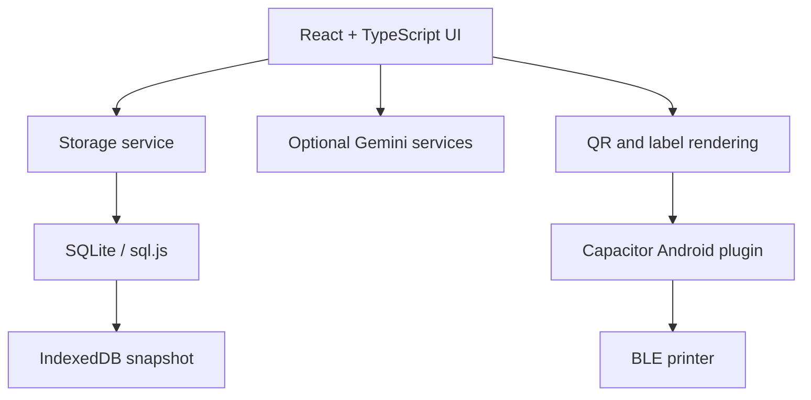

# Boxing AI / BoxTrack AI 📦

**A local-first inventory for locations, boxes and the items inside them.** Built as a React web app/PWA with an Android wrapper and optional AI-assisted item entry.


> A real application screenshot has not yet been added to this repository. The image above is its existing project banner.

## Highlights

- Organize `location → box → item`, with box categories and QR scanning.
- Prevent deleting a location that contains boxes or a box that contains items.
- Persist SQLite data locally through `sql.js` and IndexedDB, without a required account or server.
- Optionally extract item details from image or audio with Gemini; ask questions about the inventory.
- Render labels and connect to a NiiMBOT B1 Pro through the Android Bluetooth printing path. Printer behavior needs verification on the physical device.

## Architecture



`App.tsx` orchestrates the interface. `services/storageService.ts` owns the database and integrity rules; `services/geminiService.ts` handles optional AI calls; `components/` contains scan and voice input; `services/labelRasterRenderer.ts` and the Android Java classes implement the print path. Tests cover storage, AI services, label rendering and BLE protocol behavior. The AI key is used on the client and can be exposed to a user of the app; restrict its permissions and quota accordingly.

## Run and test

Prerequisites: Node.js/npm. AI features require a personal Gemini API key; inventory works without it.

```bash
git clone https://github.com/luisfelipealves/Boxing-AI.git
cd Boxing-AI
npm ci
npm run dev
npm test
npm run build
```

For Android, install the Android SDK and JDK required by the Gradle project, then:

```bash
npm run build
npx cap sync android
cd android
./gradlew assembleDebug
```

The existing [Android release workflow](.github/workflows/android.yml) builds on `v*` tags. Signed releases require `ANDROID_KEYSTORE_BASE64`, `ANDROID_KEYSTORE_PASSWORD`, `ANDROID_KEY_ALIAS` and `ANDROID_KEY_PASSWORD` repository secrets; retain the same keystore for future updates. The project [README history](.ai/README.md) and `.ai/product/` and `.ai/development/` folders record the team workflow and decisions.

## How we built it

I supplied the real inventory use cases and made product decisions, including safe deletion and printer requirements. We split the work into product decisions, development tasks and agent branches; implemented in small steps; ran targeted tests and builds; and used physical-device testing as a gate before merging device features. The repository's `.ai/` artifacts preserve questions, handoffs, reviews and human approvals rather than relying on chat history.

## Portfolio snapshot

**Role:** product owner and technical direction with AI-assisted engineering. **Highlights:** local SQLite persistence, referential integrity, optional multimodal AI, QR labels, Android/Capacitor and BLE integration.
